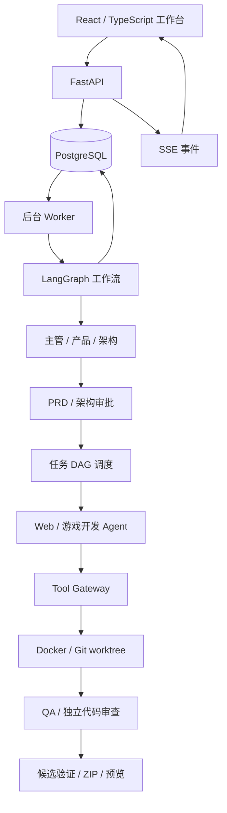

# 多 Agent 软件协作开发平台

基于 LangChain、LangGraph 和 FastAPI 构建的本地多 Agent 开发平台，面向 Web 应用与浏览器游戏开发，将需求分析、人工审批、任务拆解、开发执行、测试审查和交付管理连接到同一工作台。

平台运行在 Windows，PostgreSQL 和项目开发、测试环境运行在 Docker，前端使用 React 与 TypeScript。

## 核心功能

| 功能 | 实现方式 |
| --- | --- |
| 多 Agent 协作 | 主管、产品、架构、Web 开发、游戏开发、QA、代码审查七类角色，通过 LangGraph 编排流程 |
| 人工审批 | PRD 与架构方案分别审批，支持修改重提，审批关联具体文档版本 |
| 并行开发 | DAG 依赖调度、Git worktree 独立工作区、并发控制与串行集成 |
| 工具执行 | 统一 Tool Gateway，封装文件、命令、Git 与测试操作，通过 Docker 和路径校验约束执行范围 |
| 持久恢复 | PostgreSQL 状态存储、LangGraph 检查点、Worker 租约与心跳、幂等校验及执行结果核对 |
| 质量验证 | 固定候选 SHA，执行浏览器测试及独立代码审查，修复后重新验证 |
| 交付管理 | 生成包含源码、运行说明、测试资产和报告的 ZIP，提供独立预览 |
| 可视化工作台 | 查看文档、审批、任务依赖、测试报告和模型调用，通过 SSE 同步事件 |

## 系统架构



## 技术实现

- **流程编排：** 使用 LangGraph StateGraph 定义流程，通过 Pydantic 校验结构化输出，结合 interrupt 与检查点实现审批等待及恢复。
- **任务与版本：** 校验 DAG 依赖，为开发任务分配独立工作区；构建、测试和审查关联具体候选及 Git Commit SHA。
- **执行可靠性：** 通过持久化工作项、操作回执、租约、心跳和版本校验，处理重复投递、中断恢复与失效 Worker 写入。
- **模型调用优化：** 按补正目标组织上下文，去除源码与 diff 的重复内容；按候选、文档和测试版本校验已有审查结果后复用。
- **质量修复：** 区分源码缺陷、测试步骤和运行环境问题，进入相应修复流程；新候选重新执行适用测试及审查。

## 本地运行

### 环境要求

- Windows、Docker Desktop（Linux 引擎 / WSL2）
- Python 3.12、uv、Node.js / npm、Git
- Microsoft Edge（本机浏览器测试使用）
- 支持相应模型能力的 API 配置

### 安装依赖

在仓库根目录执行：

```powershell
cd backend
uv sync --locked --python 3.12
Copy-Item .env.example .env
cd ../frontend
npm ci
cd ..
```

复制 `.env` 仅用于首次安装；已有配置请直接核对，不覆盖。模型 Key 通过工作台保存到 Windows 凭据管理器，不写入仓库。

首次运行还需初始化数据库、执行迁移并构建与当前配置匹配的执行和质量镜像。镜像存在版本依赖，请按[安装与运行手册](docs/36-v1-operations-manual.md)及[本机开发说明](docs/11-local-development.md)完成准备；当前默认配置见 [backend/.env.example](backend/.env.example)。

### 已完成初始化后的启动

先启动 Docker Desktop，然后在仓库根目录执行：

```powershell
.\platform.ps1 preflight
.\platform.ps1 start
.\platform.ps1 status
```

| 服务 | 本机地址 |
| --- | --- |
| 工作台 | http://127.0.0.1:5173 |
| API 文档 | http://127.0.0.1:8000/docs |
| 独立预览 | http://127.0.0.1:8001 |

在工作台配置模型并完成能力检测后，创建项目、提交需求，依次处理 PRD 与架构审批，再查看开发任务及质量报告。模型能力检测与项目运行会产生供应商 API 请求。

## 当前范围

本项目定位为 Windows 本机个人开发平台，支持受控环境下的 Web 应用与浏览器游戏开发，不包含团队协作、任意仓库导入或任意业务后端部署。

已实现多 Agent 编排、审批、并行开发、持久恢复及候选验收，历史阶段已有真实模型项目交付记录。当前仍在完善平台可靠性，F09 最新真实模型自主交付验收尚未通过；历史阶段结果不代表当前版本已完成全部验收。

## 文档导航

| 文档 | 用途 |
| --- | --- |
| [产品范围与决定](docs/01-product-scope-and-decisions.md) | 功能范围与已确认约束 |
| [多 Agent 实现方案](docs/08-multi-agent-implementation-blueprint.md) | 角色协作与实现设计 |
| [安装与运行手册](docs/36-v1-operations-manual.md) | 环境准备、启停、备份与恢复 |
| [模型配置](docs/07-model-configuration.md) | 模型接入与凭据管理 |
| [可靠性修复清单](docs/75-platform-repair-backlog.md) | F01—F09 跟踪与关闭条件 |
| [当前开发交接](CURRENT_HANDOFF.md) | 最新执行断点与工作边界 |
| [开发记录归档](docs/readme-development-history.md) | 原 README 的完整历史记录 |

## 目录结构

```text
backend/       FastAPI、Agent 工作流、Worker、工具与测试
frontend/      React / TypeScript 工作台
infra/         数据库配置、Docker 执行与质量镜像
docs/         设计、安装说明及验收记录
platform.ps1   本机平台管理入口
```
