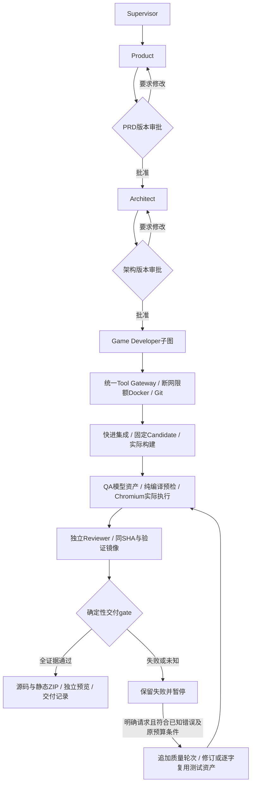
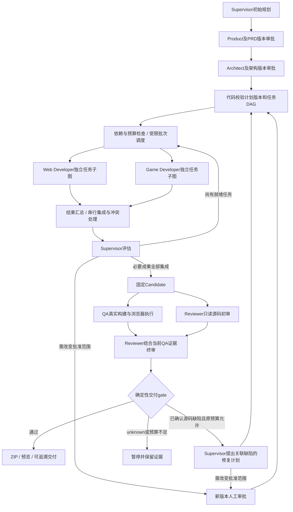
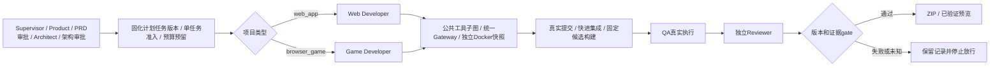
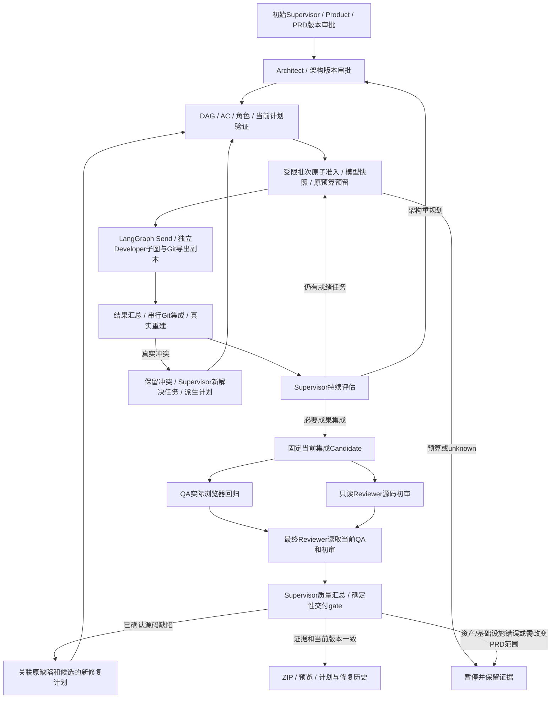
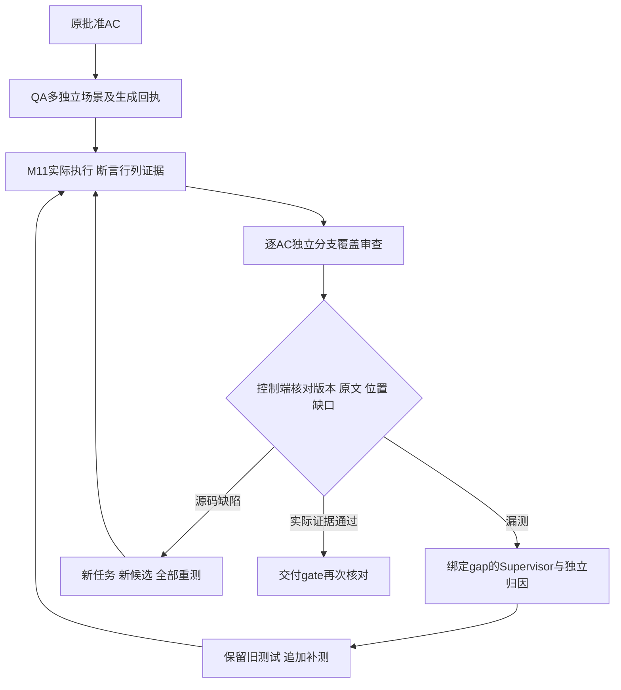

# 多 Agent 实现蓝图

2026-10-25项目驱动架构复盘见docs/61：此次故障暴露源码候选继承与QA资产修订链混用、授权条件依赖列表位置、环境复验缺少末端资产不变量的问题。以共用质量控制逻辑和跨入口反例修正，不通过新增角色、手改业务源码或放宽审批解决；上轮全量与本次增量验证分别报告。

2026-10-24全链路复审（docs/58）：沿用同一主图、七角色、业务账本和Gateway，不新增旁路执行器。新增持久审查反馈回边和质量移交完整性强校验；原工作项、拒绝方案及原断言保留。隔离真实PG/Docker/Git/Chromium的Web/Game主图交付夹具均通过，不能据此冒充原贪吃蛇真实模型最终交付。

2026-10-24质量纠错实现补充：Supervisor依据固定失败/批准文档/源码分类，Reviewer先独立复核归因，QA按固定单项工作键生成局部步骤修订或原要求补测；控制端AST检查与持久摘要通过后，再由Reviewer独立审查修复计划。Developer只处理确认源码缺陷，经Gateway检查/提交/集成生成新候选；QA完整复验、最终Reviewer和原交付gate仍必需。七角色、真实LangChain/LangGraph及原checkpoint不变，不为纠错另造一套绕过执行层的助手。规则授权见docs/56，当前验收见docs/57。

状态：实现方案草案，尚未编写业务代码。日期：2026-10-19。

历史说明：本文为编写代码前的完整蓝图；当前已实现阶段及边界见 docs/17，不能将本方案中后续阶段的拓扑和并行能力当作已实现。

2026-10-20用户确认调整顺序：M1之后先执行M3协作闭环，再完善M2通用恢复。详细步骤、必要保护和验收见docs/18；下文“先M2再M3”的原编码顺序据此更新，恢复与并行目标不删减。

本文具体化七角色协作的实现方式。React、FastAPI、PostgreSQL 等沿用候选技术组合，不把本文件视为用户已逐项确认选型。

## 1. V1 运行拓扑

平台前端 → API → PostgreSQL 中的运行任务/outbox → 独立 Worker → 项目 LangGraph 主图 → 角色执行器/任务子图 → LangChain 模型与工具 → Tool Gateway → 项目执行环境。

API 只提交、查询和恢复工作，不在 HTTP 请求中跑完整开发流程。首版一个 Worker 进程可协调一个活动项目，并在进程内异步并行执行独立任务。不是为七个角色各启动一个常驻服务。

队列负责领取项目运行的启动/恢复动作；LangGraph 内的调度节点负责该项目的业务任务。首版不再让另一套任务队列同时调度相同开发任务，避免双重领取和状态竞争。

同一个 run_id/thread_id 同一时刻只允许一个 Worker 持有有效运行租约。等待审批时图中断，释放执行资源；API 保存决定并投递恢复动作。后续扩大多项目并发时再增加 Worker，仍遵守同一运行单协调者。

## 2. 建议代码目录

```text
backend/
  app/
    api/                     # 项目、运行、审批、模型配置、查询和事件
    domain/                  # 状态机、Pydantic 合约、验收与预算规则
    db/                      # ORM、事务、迁移与 repositories
    worker/                  # 工作领取、租约、心跳、启动和恢复
    workflows/
      project_graph.py       # 项目主图与条件路由
      state.py               # 主图 State 和结果 reducer
      approvals.py           # 版本化审批节点
      scheduler.py           # DAG 校验、就绪任务选择、额度控制
      task_graph.py          # 单个角色任务的模型/工具循环
    agents/
      registry.py            # role → AgentSpec
      supervisor.py          # 初始计划、进度评估、修复提案
      product.py             # PRD 合约与上下文
      architect.py           # 架构、接口、任务计划合约
      web_developer.py
      game_developer.py
      qa.py
      reviewer.py
      prompts/               # 可版本化角色指令
    models/
      profiles.py            # 模型配置和绑定解析
      factory.py             # 按配置版本创建 LangChain 模型实例
      capabilities.py        # 连接、工具和结构化能力校验
      credentials.py         # 控制端秘密存储
    tools/
      definitions.py         # LangChain Tools 参数与包装
      gateway.py             # 身份、路径、预算、调用记录
    services/
      workspace.py
      execution.py           # Docker 命令、进程查询和取消
      git.py                 # worktree、提交、串行集成
      testing.py
      artifacts.py
      delivery.py
    events/                  # 持久事件和对外推送
  tests/
frontend/                    # 项目工作台、审批、模型设置等
infra/                       # 基础服务与执行环境配置
```

角色文件保存特有的上下文与输出规则，公共执行循环复用 task_graph；避免复制七份几乎相同的模型调用代码。

## 3. 角色定义与输入输出

AgentSpec 包含 role、prompt_version、output_schema、工具集合、上下文组装器、预算策略。模型在每次任务执行开始时从绑定解析，不固化在角色类中。

主要合约：ProductResult、ArchitectureResult、SupervisorDecision、TaskResult、QAReport、ReviewReport。使用 Pydantic 校验角色最终输出；LangGraph 内部 State 可以采用 TypedDict，避免把所有对象和模型实例塞进检查点。

SupervisorDecision 的候选动作限定为 plan、continue、replan、request_human、propose_delivery。模型提案须再经代码校验；它不能直接运行任意角色或设置项目成功。

## 4. 主图节点与职责

| 节点 | 行为 | 输出 |
| --- | --- | --- |
| initial_plan | Supervisor 提阶段计划 | 计划草稿引用 |
| product | Product 生成/修订 PRD | 不可变文档版本 |
| prd_approval | 准备审批并持久化中断 | 批准或修改意见 |
| architect | Architect 生成/修订架构与任务 DAG | 架构、计划版本 |
| architecture_approval | 用户确认具体架构版本 | 批准或修改意见 |
| validate_plan | 代码检查角色、依赖、验收和基线 | 有效计划或校验错误 |
| select_ready | 按依赖、集成状态、预算和额度选本轮任务 | 带稳定 execution_id 的任务批次 |
| execute_task | 调用对应 Agent 的任务子图 | 按 execution_id 索引的结果引用 |
| collect_results | 核验并持久化本轮结果 | 成功、失败、阻塞分类 |
| integrate | 单一集成流程合并代码 | 集成状态、候选 SHA |
| assess_progress | Supervisor 读取阶段结果，评估继续/重规划 | 受约束决策 |
| quality_checks | 在同一候选上并行执行 QA、Reviewer | 两份版本绑定报告 |
| assess_quality | 汇总缺陷，提出修复或交付 | 修复计划/交付建议 |
| delivery_gate | 确定性检查验收覆盖、证据和版本 | 通过或缺项清单 |
| deliver | 打包并登记实际交付物 | manifest 引用 |

图边表达审批回退、开发循环和修复循环。开发执行错误先转为可记录的失败结果；租约失效、取消等控制异常停止整个运行，不伪装成普通业务缺陷。

## 5. 主图与局部 State

主图保存：project_id、run_id、当前阶段、批准文档引用、plan_version、当前批次 ID、任务执行结果引用、candidate_id、审批引用及暂停原因。

子图保存：task_id、execution_id、attempt、角色、模型配置快照、任务消息、当前工具调用引用、剩余步数、最终结果引用。

消息保存在任务自己的状态空间，不把所有角色的聊天混进同一个 messages。模型实例、连接、凭据和服务对象通过运行时依赖注入，不进入持久化 State。

## 6. 单个 Agent 的内部执行循环

```text
prepare_context
  → check_cancel_lease_budget
  → call_model
     ├─ 有工具请求 → validate_tool_request → execute_via_gateway
     │                                     → append_tool_results → call_model
     └─ 无工具请求 → validate_final_output
                         ├─ 可修正格式错误且预算允许 → call_model
                         └─ 输出结果 → verify_evidence → persist_result
```

LangChain 负责创建/绑定模型与工具 schema、消息转换、结构化输出适配。模型请求工具后，只有 Tool Gateway 实际执行文件、命令、Git 或测试操作。

Product 等以文档结构化产出为主的角色，可走较短路径；Developer 使用完整工具循环。模型说完成只是候选结论，必须核对实际文件、提交、退出结果和验收证据。

每次有副作用的工具调用先生成稳定 tool_call_id 并记录执行意图；完成后保存结果。重入时读取已有结果或核对进程，不能简单再次调用。

## 7. 并行实现：受限批次

建议 V1 使用受限批次，而非一开始实现持续补位的分布式调度：

1. select_ready 查询数据库中的有效计划与任务；依赖成果必须已集成。
2. 根据额度选择最多 N 个就绪任务，原子登记 execution_id 和模型快照。
3. 主图通过 LangGraph Send 将每个任务的局部输入发给 execute_task。
4. 并行分支只返回自己的 execution_id → result_ref；reducer 合并并去重，不让多个分支覆盖 phase、plan_version 等公共字段。
5. 等本批次结束，collect_results、integrate、assess_progress 后再选择下一批。
6. 没有就绪任务时区分完成、阻塞和无效依赖，不能无限空转。

这个方案存在批次屏障：较慢任务会推迟下一批启动。第一版接受这项效率折中，换取清晰的状态和恢复语义；后续确有瓶颈再实现完成一个补一个的事件调度。

工作流的并行分支与 Docker 命令的 CPU 并行是两个层次。相同资源需要额度限制；并行任务使用独立 worktree、进程及端口。数据库/队列不自动带来代码写入隔离。

## 8. 审批与检查点

以 run_id 为基础建立稳定 thread_id。文档生成节点和审批节点分开，避免审批节点重入时重复生成文档。

审批节点幂等准备 approval_id，再以 interrupt 暂停。API 将审批决定及恢复动作原子保存，Worker 校验审批/中断对应关系后使用 Command(resume=...) 恢复同一 thread_id。

同一运行同一时刻只允许一个待处理的人工中断，减少恢复路由歧义；并行开发分支报告 blocked，由汇总阶段统一请求人工处理。

持久 Checkpointer 负责图状态；执行表与工具日志负责副作用对账。不能只装上 Checkpointer 就承诺命令或 Git 操作恰好执行一次。

## 9. 模型工厂与切换

resolve_binding(project_id, role) → 读取配置 revision → 校验角色能力 → 创建模型 → 绑定允许工具 → 启动任务子图。

每次调用记录配置版本和模型名，Key 仅由模型工厂在控制端取用。更改默认绑定不修改活动执行的快照；新执行使用新选择。暂停后切换则核对旧工具结果、保存代码与摘要，新建 continuation 执行并继承原任务预算和尝试计数。

任务续接需要记录父执行 ID；它不等于把未知副作用当失败后自动重试。原始供应商专有消息不直接跨模型复用。

## 10. 持久化边界

业务表至少覆盖 projects、workflow_runs、documents、approvals、plans、tasks、task_dependencies、task_executions、tool_executions、integration_records、candidates、artifacts、project_events、work_items/outbox、model_profiles、model_bindings。

这是一份实体清单，物理表是否合并在建模阶段确定。审批、候选、报告、任务与计划的版本引用需要明确外键和唯一约束。

Worker 重启先获得运行租约，读取检查点并核对执行记录，再继续图。发现活动进程或结果不明时先对账，不因为图节点重放而重新创建任务分支、重复 Git 合并。

## 11. 首次编码的交付顺序

1. 定义并测试 TaskSpec、AgentSpec、角色输出、状态转换和模型配置合约。
2. 初始化候选技术栈，迁移最小数据模型，实现运行任务领取和模型配置。
3. 接通一个真实 LangChain 模型及无副作用工具调用闭环。
4. 接通 Supervisor → Product → PRD 审批 → Architect → 架构审批的持久主图。
5. 加入一个 Developer 任务、文件/命令/Git Gateway、真实游戏与候选版本。
6. 接通 QA、Reviewer、证据门槛与交付（M1已验收）；随后按docs/18先完成必要保护、Web角色、依赖/并行集成与源码修复，再完善M2通用恢复。

第一条端到端验收：配置模型 → 创建游戏项目 → 两次审批 → 真实代码开发 → 同版本测试审查 → 可运行交付。之后再验证两个独立开发任务的并行与冲突处理。

## 12. 官方参考

- [LangGraph Graph API](https://docs.langchain.com/oss/python/langgraph/graph-api)：StateGraph、Send、并行 super-step 与 reducer。
- [LangGraph interrupts](https://docs.langchain.com/oss/python/langgraph/interrupts)：持久化中断、恢复与节点重入。
- [LangChain models](https://docs.langchain.com/oss/python/langchain/models)：模型、工具调用与结构化能力。

## 13. M1 实际执行图（2026-10-20）

下图为已验证的单开发任务切片；上文并行质量、DAG、worktree及自动修复仍为后续蓝图，不混作当前能力。



测试修订不改业务源码和批准基线；原资产重验不再调用QA生成模型，仍实际执行全部测试并用原剩余预算调用独立Reviewer。未知工具、源码阻断、产品断言失败不能走该入口；不会将每个暂停当作自动重试。检查点/工作项/质量轮次规则见docs/16及实际schema。

## 14. 下一阶段目标图（计划，尚未实现）



Web/Game按任务角色分派，不要求每项目调用两者。修复返回调度后必须生成新SHA/新Candidate再完整验收；图中的返回不表示可覆盖旧报告、重置预算或绕开审批。质量并行不消除终审对当前QA结果的依赖。

## 15. C0/C1 实际增量（已验收）

2026-10-20通过证据见docs/19。当前实际路径是在两次审批后固化Plan/PlannedTask，在运行锁内检查身份、基线、unknown和单任务额度并预留原预算，随后按project_type路由Web或Game Developer，公共子图经Gateway调用真实工具，再进入固定候选、串行QA/Reviewer和交付gate。Web任务清单已真实交付，后端完整146项通过。



第14节完整目标图中的持续Supervisor、DAG调度、并行worktree、冲突解决和源码修复循环仍未实现。Plan表和七角色已接通不能替代这些阶段验收。

## 16. C2—C5实际增量

实施、测试与未通过项见docs/20；上节为C0/C1历史切片。新路径通过`batches.py`真实Send/reducer、`scheduler.py`确定性准入、`integration.py`Git控制端及`repair.py`派生计划连接，不是仅增加七角色枚举。完整M3/C6仍需独立综合验收。四任务真实模型项目经用户明确仅此运行30→45授权后，最终44次调用完成真实交付；源码缺陷修复另有真实模型证据，均见docs/20。



现有重规划可生成新架构版本并重新审批，原PRD保持批准基线；需要改变PRD范围则暂停请求处理，尚未提供任意运行中需求变更入口。M2完整故障恢复、活动任务换模型和M4正式SSE不因协作路径落地而被标记完成。所有业务写入仍经Gateway/控制端身份与版本核验，构建不能把修改过的Git元数据写回权威集成仓库。


动态批次、Developer和质量子图显式`checkpointer=False`，避免主图节点重入后按旧调用位置复用另一execution_id/candidate_id的子图检查点；主图PostgresSaver、持久业务记录、原预算、版本/租约/unknown门槛仍保留。中断副作用必须核对后才继续，不因此承诺M2通用自动恢复。

C6综合验收更新：第16节实际拓扑已完成docs/21综合验收，原M3协作闭环通过。七类角色由正式游戏、Web、四任务及真实修复历史整体覆盖；另有真实Docker/Git进程重叠、集成后依赖、同文件冲突/祖先核验、缺陷新候选及完整质量回归证据，均明确模型fixture与真实模型边界。下一阶段M2可靠性，随后M4/M5；历史图和原始PROJECT_CONTEXT不改写为当时已完成。


## M4 已落实的事件与工作台拓扑（2026-10-21）

工作台先GET项目workbench一致快照，获得同事务水位，再连接独立SSE端点；Event与业务一起提交，以Run锁→项目head锁分配项目内stream_seq。API短事务分批追赶，浏览器按UUID去重并合并刷新；连接故障查询补偿，15秒心跳、40秒失活检测。原events API保留，新history固定水位分页。工具日志在结果持久化后展示，未引入模型私有思考或伪实时stdout。正式代码`event_stream.py`、`workbench_actions.py`、`quality_assets.py`及前端独立组件，协议/门槛和完成证据见docs/31—33。七类Agent和原主图/子图、Gateway隔离与审批恢复合同不变。
# 2026-10-23恢复链路补充

详见[docs/54执行链路复审](54-execution-architecture-audit.md)。LangGraph保留阶段位置，细粒度工具、源码、集成与验收状态继续由持久账本/不可变回执共同决定，不能只看图节点位置宣称能续接。已知集成构建失败的恢复recipe显式进入主管诊断，不得进入旧成功开发任务的再次合并。具备完整入口的Vite任务在声明完成前还须通过真实类型检查/构建，普通源码错误直接返回同一Developer循环修复；并行部分模块保留，合并与最终质量门槛不降低。

任何未完成历史轮次可人工打开恢复，原run/thread、源码、审批和消耗保留；同项目业务工作按租约及未停止进程状态串行，不自动取消其他轮次。切换profile或思考协议无法重放已脱敏推理历史时，使用原源码、工具结果及最新核准修复指引构造中性上下文；不复制私有推理，不重放未知工具。

2026-10-23增量：completion_recovery位于统一自动纠错入口之前，仅处理有可信成功检查、尚未完成结果上报的停滞工作，通过原request_check/request_resume和持久子尝试续接。Developer内部将有证据的收尾与普通工具探索区分，Gateway仍唯一执行入口；没有合格证据回原主管诊断。进展保护分别记录源码、检查、构建、提交里程碑，原重复/循环防护保留。批量进程核对仅优化观测，原身份/租约/未知结果门槛不变。见docs/55。

首次验证补充：已写入但从未实际检查的固定Vite合同任务，可凭匹配当前源码的不可变写入回执，经同一协调器与原恢复检查点安排一次平台本地构建。Developer在模型调用前执行原Gateway固定类型检查/构建；结果进入原修复循环，不以写入当完成，不执行任意新脚本，不重放失败或未知检查。只有实际首检回执才成为新诊断事实；源码变动不能继承授权，最终质量门槛保留。实测与边界见docs/55。

2026-10-24接线补充：架构必须明确DOM/Canvas/UI、批准初始状态和事件卸载的创建/接线责任；集成验证不能只以纯逻辑单测或构建代替实际页面加载。当前已批准架构不静默修改，缺陷依原scope审查形成修复任务。模型输入采用source-check-v2，保留批准目标、当前分工源码及最近有效检查，详见docs/03与docs/55。已知测试API误用按质量修订合同分类，与真实源码缺陷分别处理，最终仍在同一新候选完整QA和独立审查。


## 2026-10-25 质量节点细化（docs/62）

沿现有LangGraph、Gateway及七角色执行，未新增角色或绕过审批。quality.initial_qa_plan生成多场景及回执，M11执行真实独立上下文；coverage_review按AC调用独立Reviewer并持久化签名结果引用，acceptance_coverage验证位置和缺口，quality_correction绑定gap进入原补测/独立归因流程，delivery重新验证。progress_guard仅认可StructuredResult实际匹配的生成/审查分段，不取消重复、无进展、失租、未知结果保护。


