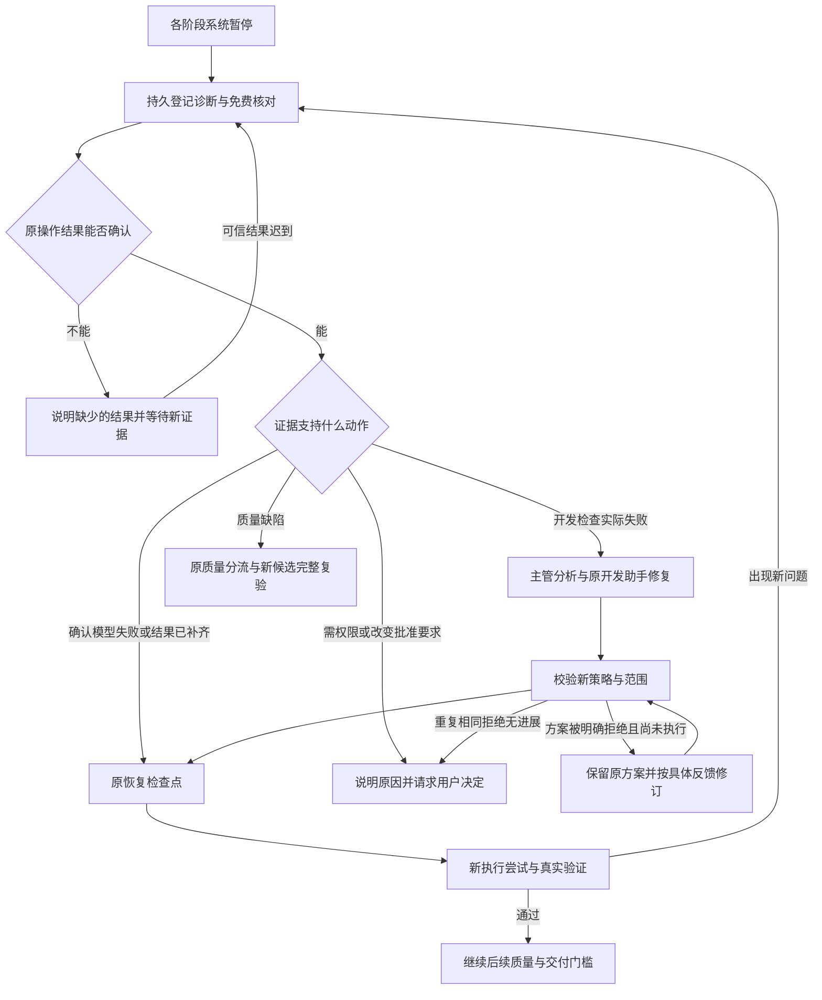

# 面向后续项目的统一故障恢复

2026-10-27实现补充：共用质量全回执对账、原批次续接、已知失败配方进入诊断路由；语义指纹识别真实质量/当前模型/迟到打包回执变化，不以新ID、批次或调用数增加机会。未知结果与存储不可用准确阻断，原授权及门槛保持。源码、实际验证、部署和剩余真实模型验收见[docs/68](68-autocorrection-chain-audit.md)。

2026-10-23。用户授权按“各阶段遇错→取证→分流→修复→验证→继续”设计并实施。docs/49只证明原推方块闭环，不能证明任意未来故障均可修复。本次补齐共用调度层，保留docs/02、04、26、40、44、46、48中的审批、隔离、证据与验收边界。

## 架构与状态

所有按进展运行的系统暂停均进入统一故障观察入口，无需新增错误码才能开始免费检查。人工暂停、取消、等待审批和终态不自动续接。原已知纠错路径继续优先工作；未被其处理的问题，持久登记诊断事项并调用原恢复检查器。检查只读取进程、操作回执和检查点；补记结果必须有可信回执，不能重做未知操作。

诊断事项使用原WorkItem和RecoveryAction，不另建内存队列：观察→检查中→已分流/已续接/需协助。Worker重启继续处理，运行行锁及唯一action_key防并发重复。诊断指纹不使用时间、调用次数、尝试ID或模型文字；同一成果上没有新证据不能反复消耗模型。

方案中的“修复前第一步”与“修复后复测”分开处理：原代码上重复失败命令不能直接获准；明确未执行的方案可收到平台反馈后修订。每种已核实的拒绝原因在当前成果上只提供一次新诊断机会，换措辞不增加机会，不设置正常项目的累计修复轮数上限。全部旧方案和失败回执保留。

分流依据是操作状态、真实失败、批准基线、阶段和恢复检查结果，而非只看异常名称：

- 开发代码/命令失败：在项目内交给原主管分析实际失败、开发助手修正，沿用原独立范围核对、恢复检查和新执行尝试。新错误名称同样适用。不能以旧工具失败推断后来发生的其他故障。
- 模型失败：确认请求已经失败且没有未知副作用，才可从原检查点续接。权限、余额或配置问题要明确提示，不能反复扣费；相同成果上的自动重试机会仍由原指纹保护。
- 工具、集成、构建、测试的应答丢失：先核对原回执，能够确定结果才续接；缺凭据或进程仍活动时保持原状并说明缺什么。
- QA、独立审查发现业务缺陷：继续使用既有修复任务→新候选→完整QA→独立Reviewer。测试自身修正受docs/46、48约束，不能通过改验收语义放行。
- 环境问题：项目内命令/文件错误可走开发纠错；平台、Docker、磁盘、权限等宿主环境故障只诊断和明确提示，不让业务Agent获得宿主权限或自行改平台程序。

每次应用前重新核验批准版本、快照、任务状态、检查点、租约和取消。恢复检查“ready”只是必要条件，不代表业务已通过，也不单独授权重试。证据不支持安全动作时说明具体障碍；不承诺所有错误都能无人工处理。

## 要求与验收映射

|编号|要求|模块|验证|
|---|---|---|---|
|G01|新错误也进入诊断，覆盖各阶段|general_recovery + auto_correction.tick|多阶段未知故障注入、实际PG持久记录|
|G02|未知操作先对账，不能盲重放|原recovery_service/adapters/journal|真实回执恢复、缺失/篡改/活动进程拒绝|
|G03|非错误码限定的开发修复|证据路由 + 原CorrectionPlan/Strategy|Web/游戏不同未知错误→方案→检查→新尝试|
|G04|模型故障有条件续接|失败Invocation + 恢复recipe|规划/开发/质量阶段，权限配置拒绝，不能把running视作失败|
|G05|无新成果不循环，无累计次数上限|原纠错指纹 + 语义诊断指纹|重启/并发/重复失败/更换ID或文字不能增加机会|
|G06|取消、人工暂停、审批及隔离不变|原控制/恢复层|控制边界、陈旧基线、跨项目拒绝|
|G07|向用户解释原因、正在做什么、需要什么|diagnostics/中文说明/工作台|API脱敏、前端状态和高级详情折叠|
|G08|真实质量和交付门槛不变|原quality_correction/quality/delivery|关联回归，真实环境专项；不把夹具当模型端到端|

## 实施顺序与报告要求

先实现持久诊断和证据路由，再接入共用Worker与中文提示，最后做隔离PostgreSQL、真实检查点/操作凭据以及工作台回归。真实模型最终验证最多1～2个项目，其余故障矩阵用明确标注的注入测试覆盖。生产部署前保留一致备份，禁止修改旧失败或把旧项目重新设为完成。实施与未验证项另记docs/51，不提前宣称所有情况通过。
