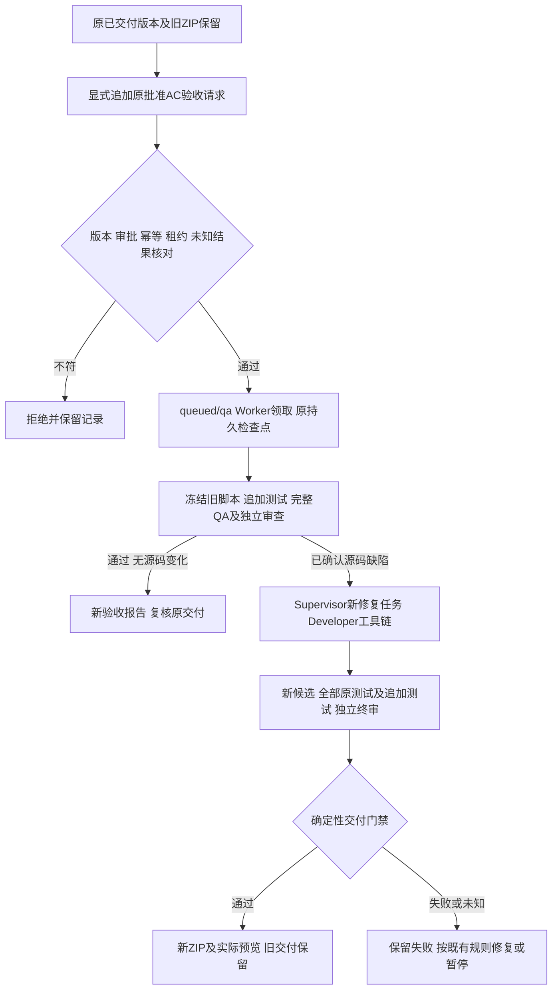

# 同轮追加验收与后续修复

2026-10-25本轮验收：该已批准窄例外已通过真实Worker/Postgres接线、冻结版完整后端840项及原计数器真实模型修复/新候选/完整复验/第二交付，原审批和旧字节保留。基线选择与修复授权列表位置缺陷已修正；完整证据、失败历史和边界见[docs/59](59-small-task-full-regression.md)。默认关闭仍保留，正式本地部署显式启用。

2026-10-25用户明确选择批准本文件窄例外：“仅显式追加原AC验收时允许原已交付运行续接，缺陷经新任务、新候选和完整复验修复”。不扩大业务范围，不授权改写原源码、审批、测试、失败记录或交付包。原待确认说明保留为提出方案时的历史；当前已批准，隔离接线与真实验收仍须完成后方可计为通过。

本次全量回归的独立浏览器检查发现：计数器已有存储方法异常测试，但在读取localStorage属性本身抛出SecurityError时白屏。原批准AC-004要求存储不可用仍可操作，属于原范围的真实遗漏，不新增业务要求。

现有quality-revisions仅用于未交付候选的受控测试用法修订，继续禁止修改已交付测试资产。新增独立的“追加验收”入口，保留所有旧源码、QA报告、通过结论的历史版本、ZIP及摘要；不编辑正式脚本或伪造失败状态，不重新生成PRD或替用户审批。

1. 显式请求绑定已发布交付、候选SHA、当前QA/Reviewer和原批准AC编号，记录独立幂等工作项；仅无租约/活动操作的已完成原轮可进入。核验批准版本及当前集成基线。
2. QA模型根据具体观察，只能给既有AC增加测试。控制端原样保留全部旧测试，至少覆盖全部请求编号；原脚本不得改写或删除。新增脚本经过既有预检、真实Docker/Chromium执行、独立审查。缺少有效执行结果仍不能重放未知操作。
3. 追加验收若发现源码缺陷，由现有分类、独立归因、Supervisor规划及Developer产生新任务/新候选；只有此显式工作项和当前真实失败报告均匹配，才允许从历史已交付候选派生修复。原候选和交付字节绝不改写，其他已交付候选仍不可直接修订。
4. 新候选重新执行全部原测试和追加测试、实际单测、独立终审及交付门禁。若追加测试通过且无源码变更，只登记新验收报告并复核原交付，不能伪称生成了新源码版本。
5. LangGraph在原轮终止检查点进入开发/质量节点，仅增加本轮质量尝试；不重做已批准分析。重新入图前再次核对epoch、候选、文档、集成基线、工作项和当前报告；重复请求只返回原工作项。

验证覆盖：正常追加且旧ZIP不变、追加失败并真实源码修复/新候选/交付、重复请求、旧QA/错误SHA/批准版本变化/未知操作拒绝、模型返回空用例/新AC/错误引用拒绝、原测试逐字保留。既有未交付修订与已发布不可篡改边界继续回归。

已批准的流程（每个门禁仍须实际验证）：

## 原规则冲突与待确认边界

本节为批准前历史。2026-10-25的明确批准仅覆盖上文限定入口；不能推广为任意终态恢复。普通终态仍采用关联运行。

docs/02第46行明确规定：“终态不直接改回running。需要继续时新建关联运行，并明确基线版本。”本方案使用原轮succeeded→queued追加验收，属于对原终态规则的窄例外，而非普通暂停恢复。代码草案和隔离测试可以准备，但正式原轮的状态转换与此入口启用须先取得用户明确确认；不能因QA漏测而直接改写终态或伪造失败状态。

建议用户确认：仅显式请求、已发布版本、原批准AC和完整旧证据均匹配时允许原轮追加验收；原审批与交付字节不变，真实源码缺陷仍经新修复任务/新候选/完整复验，不扩大业务断言或绕过未知结果。另一方案是维持原终态规则，新增关联验收运行并设计已批准基线的合法引用，不从需求分析重跑；该方案尚未实现。

上述原轮窄例外目前待确认。实施与结果续记docs/59；尚未验证的部分不记通过。
